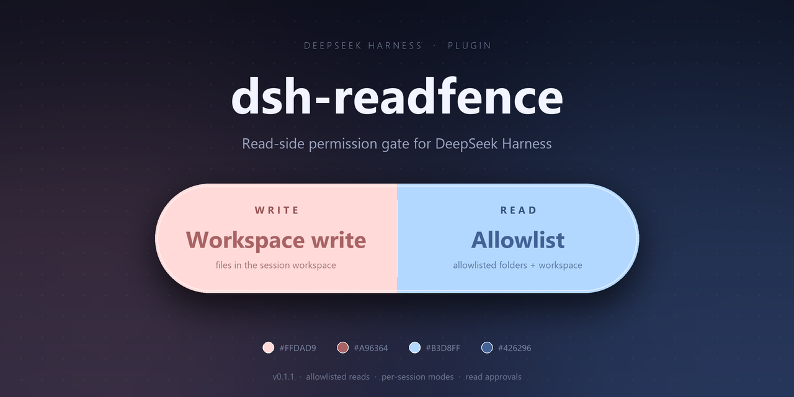
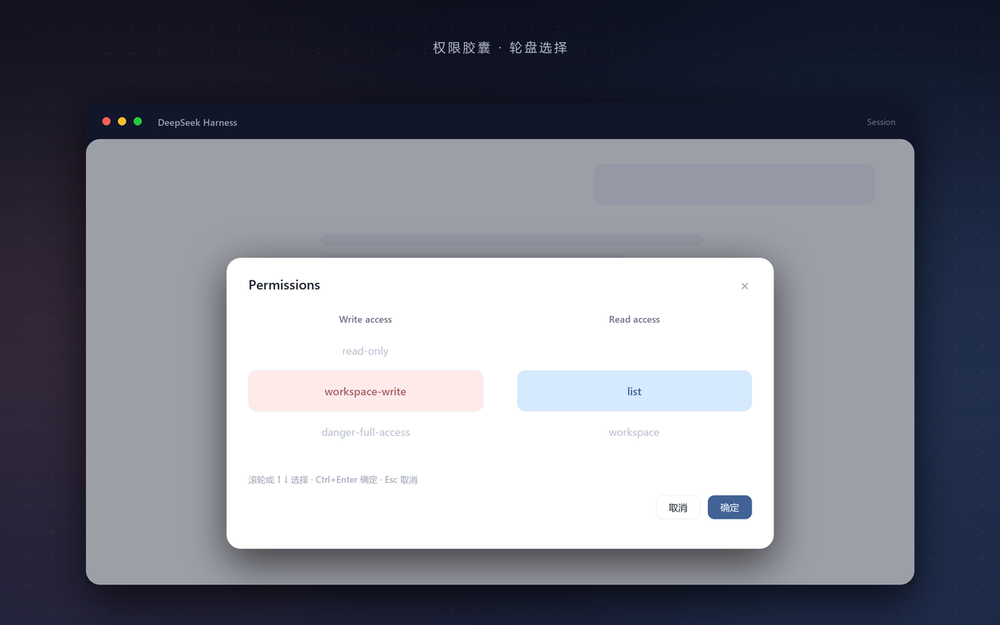
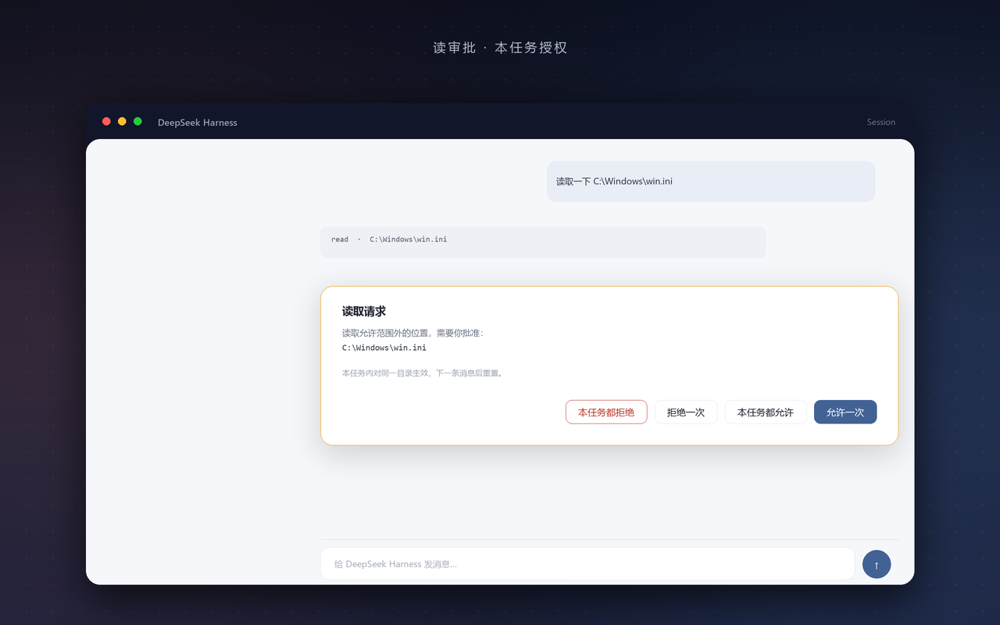
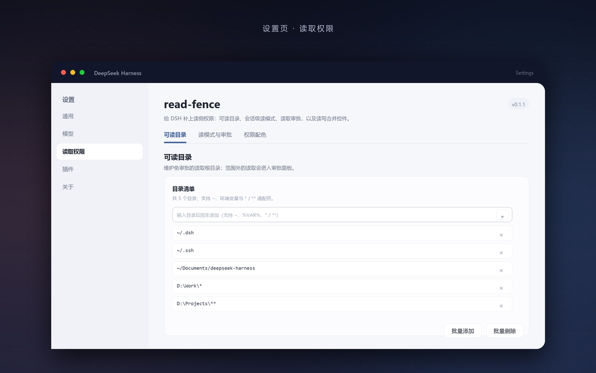

# dsh-readfence

**A read-side permission gate for DeepSeek Harness.**

[简体中文](README.md) | English




The DSH sandbox only covers **writes**: `read-only`, `workspace-write` and `danger-full-access`
all constrain file modifications, while `read`, `grep`, `glob`, `present` and the shell can still
open anything the OS allows.

This plugin adds a read check before tool execution: paths inside the allowlist run untouched,
anything outside turns into an approval prompt. It also merges the write and read permissions
into a single pill below the composer.

## What it looks like

Click the pill, pick the write and read permissions on two wheels, then press **Apply**
(or `Ctrl+Enter`) — nothing changes before that:



Reads outside the allowlist become approvals; the four buttons cover both "this once" and
"this task":



Readable folders live in the settings page, with inline add/edit/delete and support for `~`,
environment variables and wildcards:



## Features

- **Tool gate** over `read` / `read_image` / `grep` / `glob` / `present` / `pwsh` / `bash`.
- **Three read modes**: `list` (allowlist + workspace), `workspace`, `full`.
- **Per-session memory**: the mode is stored in the session log and survives restarts.
- **Task-scoped grants**: one approval covers the same folder for the current turn only.
- **Folder syntax**: `~`, `%VAR%` / `$VAR`, `*` / `**` / `?`.
- **Audit trail**: every allow, ask, deny and grant lands in `~/.dsh/read-guard.log`.

## Install

```powershell
git clone https://github.com/doushalunae/dsh-readfence.git
cd dsh-readfence
pnpm install                                  # the only runtime dependency: @deepseek-ai/schemastery
dsh plugin --profile desktop add "<absolute path to the clone>"
```

Then **restart DSH** (Host code is not hot-reloaded). To remove it:

```powershell
dsh plugin --profile desktop remove dsh-readfence
```

A `link:` install does not install the package's own dependencies, which is why the clone needs
`pnpm install` first. If you are installing from a directory that already has its dependencies,
you can skip that step.

For a manual mount, add a `link:` dependency to the profile's `package.json` and a row
`- id: read-guard` / `name: dsh-readfence` to `cordis.patch.yml`. The package must declare
`"@deepseek-ai/dsh-session": "*"` as a peer, otherwise a `link:` install cannot resolve the
host module.

## Usage

1. **Add folders**: Settings → Read access → Folders, type a path in the blank row and press Enter.
2. **Switch mode**: click the pill under the composer, pick write and read, then Apply
   (or `Ctrl+Enter`).
3. **Approve reads**: files outside the allowlist raise an approval card — choose
   "Allow once" or "Allow for this task".

Commands work too: `/read list|workspace|full`, and `/read status` prints the current value.

## Read modes

| Mode | Allowed | Best for |
|---|---|---|
| `list` (default) | readable folders **+ the session workspace** | everyday use |
| `workspace` | the session workspace only | strictest |
| `full` | everything | wide open |

## Folder syntax

Entries are **directory roots**: once a directory matches, everything below it is allowed.

| Syntax | Meaning |
|---|---|
| `~/.dsh` | the user's home directory, on all three platforms |
| `%NAME%` / `$NAME` / `${NAME}` / `$env:NAME` | environment variable; an undefined name is kept literally, no error |
| `D:\Work\*` | one directory level; `*` never crosses a separator |
| `C:\proj\**\data` | `**` crosses any number of levels; `?` matches a single character |
| `C:\proj` | a literal path, resolved with `realpath` (follows symlinks / junctions) |

Case sensitivity: insensitive on Windows, sensitive on macOS / Linux.
The built-in defaults are portable: `~/.dsh`, `~/.ssh`, `~/Documents/deepseek-harness`.

## The four approval buttons

| Button | Scope |
|---|---|
| Allow once | this call |
| Reject once | this call |
| Allow for this task | the same folder for the current turn |
| Deny for this task | the same folder for the current turn, without asking again |

The button labels are configurable in the settings page; leave a field empty to restore the default.

## Security model

This is an **application-level gate**, not a kernel sandbox:

- paths assembled at runtime inside a shell (`$p='C:\x'; Get-Content "$p\y"`) cannot be seen statically;
- network reads (`web_fetch`) do not go through it;
- it only tightens reads; the write sandbox is unchanged.

Real isolation still needs an OS-level sandbox.

## Data and audit

| Location | Content |
|---|---|
| `~/.dsh/read-guard.log` | JSON Lines with `applied` / `ask` / `deny` / `grant` / `mode` events |
| session log | the read mode is stored as a `plugin:read-guard/mode` record with `ignorable: true` |
| profile `cordis.patch.yml` | configuration overrides written by the settings page |

Third-party plugins must not invent session event types with `session.append()` — they cannot set
`ignorable`, and an unreadable event makes the whole log refuse to open. This plugin only writes
`plugin:` records; when the mapping is unavailable it degrades to in-process state and logs
`mode-unpersisted`.

## Troubleshooting

| Symptom | Fix |
|---|---|
| Opening a session fails with `unknown … not marked ignorable` | the log was corrupted; repair it with `tools/dsh-session-log-doctor.mjs --repair` |
| `this session only; the dsh-session record API is unavailable` | the `@deepseek-ai/dsh-session` peer is missing, or DSH was not restarted |
| The UI does not change | refresh the page; if that fails, restart DSH |
| The plugin is not loaded | check `read-guard.log` for an `applied` entry |

## Development

```text
lib/index.js    Host: config, commands, projection, tool gate, audit
lib/policy.js   pure functions: modes, path expansion and wildcards, candidates, decisions
lib/client.js   browser half: pill wheels, approval panel, settings page
test/           policy / host / client suites (node:test)
```

```powershell
node test\all.test.mjs    # 43 cases
```

Host plugin API details live in [docs/host-api.md](docs/host-api.md).

## License

[MIT](LICENSE) © doushalunae
