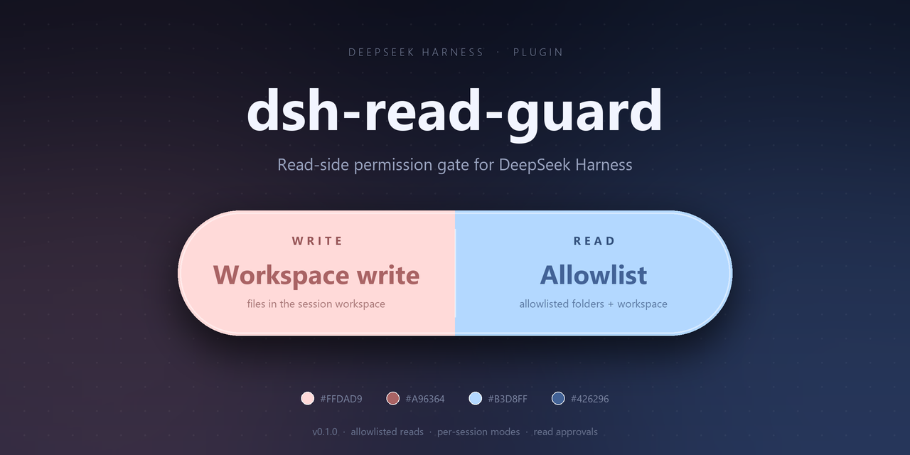
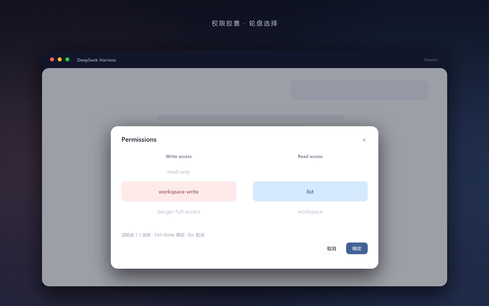
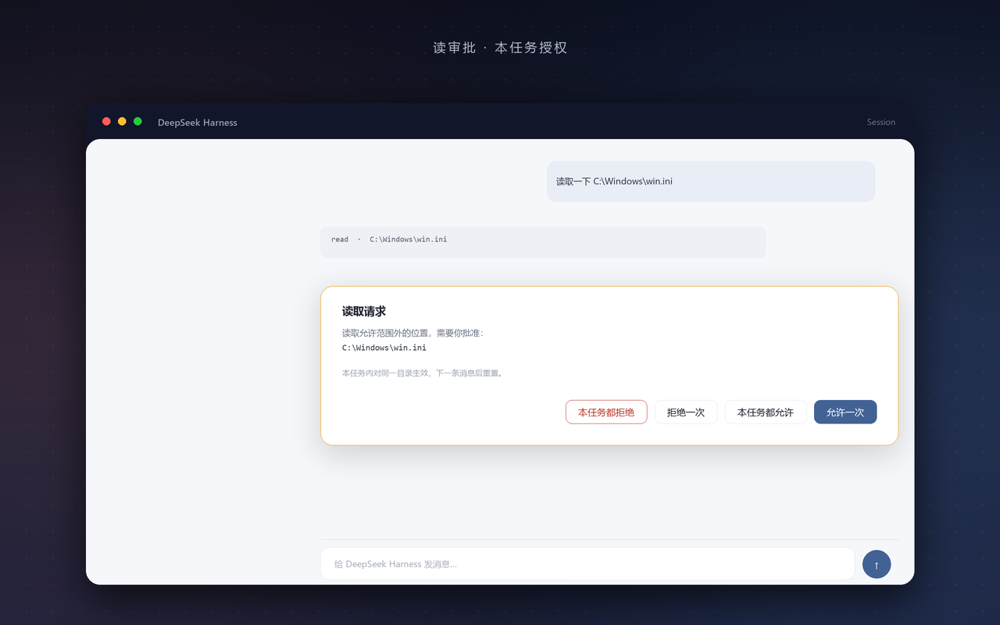
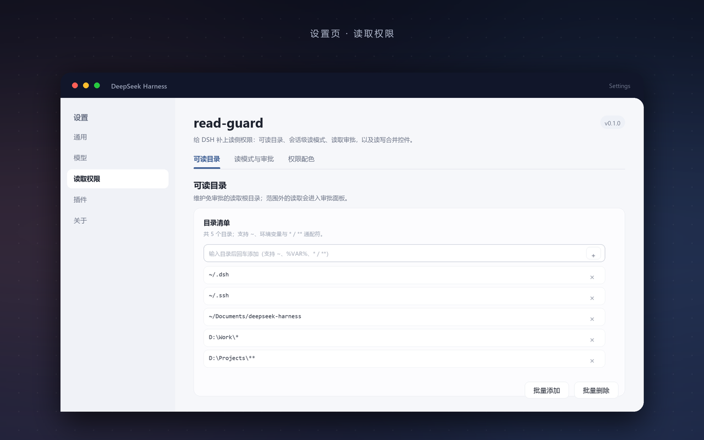

# dsh-read-guard

**给 DeepSeek Harness 补上「读」侧权限的插件。**

简体中文 | [English](README.en.md)




DSH 的沙箱只管**写**：`read-only`、`workspace-write`、`danger-full-access` 限制的都是文件修改，
而 `read`、`grep`、`glob`、`present` 和 shell 依然能读整台机器。

这个插件在工具执行前加一道读检查：白名单内直接放行，范围外弹出审批；
顺带把「写权限 + 读权限」合并成输入框下方的一个胶囊控件。

## 它长什么样

点击胶囊，在双列轮盘里选写、读权限，**确定或 `Ctrl+Enter` 才生效**：



范围外的读取会转成审批，四个按钮覆盖「这一次」和「本任务」两种粒度：



可读目录在设置里维护，支持就地增删改，也支持 `~`、环境变量和通配符：



## 功能

- **读侧闸门**：覆盖 `read` / `read_image` / `grep` / `glob` / `present` / `pwsh` / `bash`。
- **三种读模式**：`list`（白名单 + 工作区）、`workspace`（仅工作区）、`full`。
- **会话级记忆**：模式写进会话日志，重启后还在。
- **本任务授权**：一次批准只管当前回合同一目录，下一条消息自动失效。
- **可读目录语法**：`~`、`%VAR%` / `$VAR`、`*` / `**` / `?`。
- **审计**：`~/.dsh/read-guard.log` 记录每一次放行、询问、拒绝与授权。

## 安装

```powershell
git clone https://github.com/doushalunae/dsh-read-guard.git
cd dsh-read-guard
pnpm install                                  # 唯一的运行时依赖：@deepseek-ai/schemastery
dsh plugin --profile desktop add "<克隆目录的绝对路径>"
```

装完**重启 DSH**（Host 代码不热更新）。卸载：

```powershell
dsh plugin --profile desktop remove dsh-read-guard
```

`link:` 安装不会自动装依赖，所以克隆后要先 `pnpm install`；如果你直接用的是已经装好依赖的目录，可以跳过这一步。

手动挂载的话，在 profile 的 `package.json` 里加 `link:` 依赖，并在 `cordis.patch.yml` 里加一行
`- id: read-guard` / `name: dsh-read-guard`。注意 `package.json` 必须声明
`"@deepseek-ai/dsh-session": "*"` 这个 peer，否则 `link:` 安装解析不到宿主模块。

## 用起来

1. **加目录**：设置 → 读取权限 → 可读目录，顶部空白行输入路径后回车。
2. **切模式**：点输入框下方的胶囊，左右轮盘分别选写、读，`确定` 或 `Ctrl+Enter` 生效。
3. **批准读取**：范围外的文件会弹出审批卡片，按需要选「允许一次」或「本任务都允许」。

也可以直接用命令：`/read list|workspace|full`，`/read status` 查看当前值。

## 读模式

| 模式 | 放行范围 | 适合 |
|---|---|---|
| `list`（默认） | 可读目录 **+ 当前会话工作区** | 日常 |
| `workspace` | 仅当前会话工作区 | 最严格 |
| `full` | 不限制 | 完全放开 |

## 可读目录的写法

条目是**目录根**：命中某一层目录后，它下面的所有文件都放行。

| 写法 | 含义 |
|---|---|
| `~/.dsh` | 用户主目录，三平台一致 |
| `%NAME%` / `$NAME` / `${NAME}` / `$env:NAME` | 环境变量；未定义时原样保留，不报错 |
| `D:\Work\*` | 一层目录；`*` 不跨分隔符 |
| `C:\proj\**\data` | `**` 跨任意层；`?` 匹配单个字符 |
| `C:\proj` | 字面量，会 `realpath`（跟随软链接 / junction） |

大小写：Windows 不敏感，macOS / Linux 敏感。
插件内置默认值就是可移植写法：`~/.dsh`、`~/.ssh`、`~/Documents/deepseek-harness`。

## 审批的四个按钮

| 按钮 | 作用范围 |
|---|---|
| 允许一次 | 这一次 |
| 拒绝一次 | 这一次 |
| 本任务都允许 | 本回合内同一目录 |
| 本任务都拒绝 | 本回合内同一目录，且不再弹窗 |

按钮文字可以在设置里改，留空恢复默认。

## 安全边界

这个插件是**应用层闸门**，不是内核沙箱：

- shell 里运行时拼出来的路径（`$p='C:\x'; Get-Content "$p\y"`）静态识别不了；
- 网络读取（`web_fetch`）不经过它；
- 它只收紧读取，不改变写入沙箱的规则。

真正的隔离仍然需要操作系统级沙箱。

## 数据与审计

| 位置 | 内容 |
|---|---|
| `~/.dsh/read-guard.log` | `applied` / `ask` / `deny` / `grant` / `mode` 等事件的 JSON Lines |
| 会话日志 | 读模式写成 `plugin:read-guard/mode` 记录，带 `ignorable: true` |
| profile `cordis.patch.yml` | 设置页写入的配置覆盖 |

第三方插件不能用 `session.append()` 造新事件类型——写不了 `ignorable`，会让整份日志打不开。
本插件只写 `plugin:` 记录；映射不可用时退化为「仅本进程有效」并记 `mode-unpersisted`。

## 排错

| 现象 | 处理 |
|---|---|
| 打开历史会话报 `unknown … not marked ignorable` | 日志被写坏，用 `tools/dsh-session-log-doctor.mjs --repair` 修复 |
| 提示 `this session only; the dsh-session record API is unavailable` | 缺 `@deepseek-ai/dsh-session` peer，或改完没重启 |
| 界面没更新 | 刷新页面；仍不行就重启 DSH |
| 插件没加载 | 看 `read-guard.log` 有没有 `applied` |

## 开发

```text
lib/index.js    Host：配置、命令、投影、工具闸门、审计
lib/policy.js   纯函数：模式、路径展开与通配符、候选路径、判定
lib/client.js   浏览器：胶囊轮盘、审批面板、设置页
test/           policy / host / client 三套 node:test
```

```powershell
node test\all.test.mjs    # 43 个用例
```

Host 插件 API 的细节见 [docs/host-api.md](docs/host-api.md)。

## 许可

[MIT](LICENSE) © doushalunae
